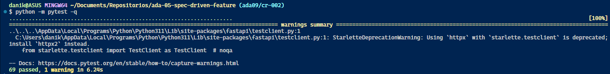
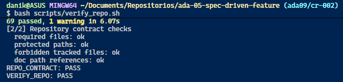

# Verification Report

## Change

CR-002

## Environment

* **Python version:** 3.11.0

* **Dependencies:**
    * fastapi: 0.138.1
    * pydantic: 2.14.1
    * pytest: 9.1.1
    * httpx: 0.28.1
    * uvicorn: 0.49.0

* **Commit reviewed:** 3e21ffc6ec5e52c4846d2468bbeba8f226da4554

## Checks

| Check | Command | Result | Evidence |
|---|---|---|---|
| Tests | python -m pytest -q | PASS |  |
| Lint | Not configured | - | - |
| Repo contract | bash scripts/verify_repo.sh | PASS |  |
| Security | Not configured | - | - |

## Overall Gate

PASS